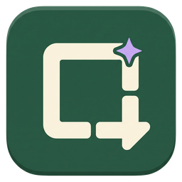
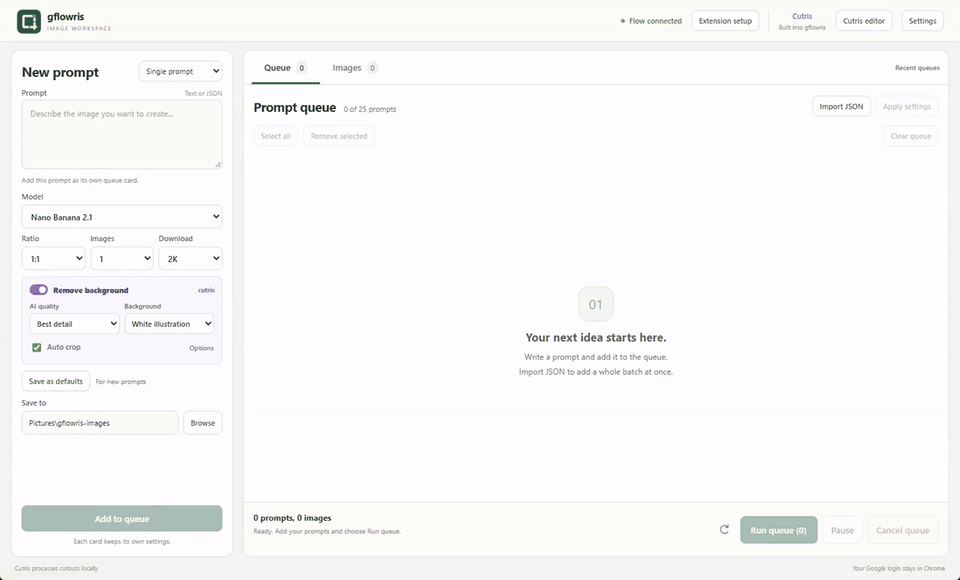
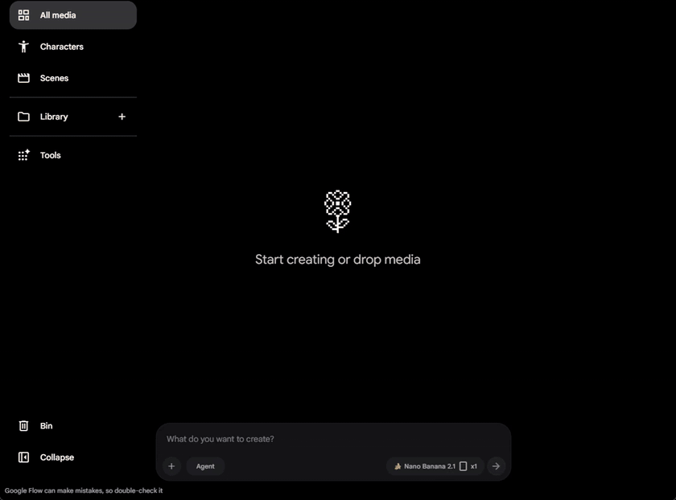
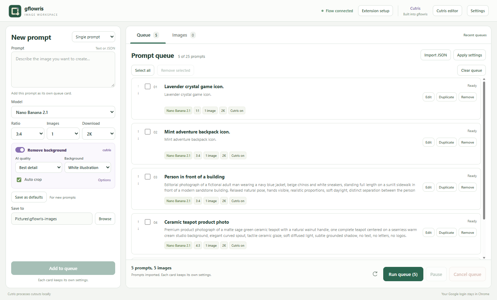
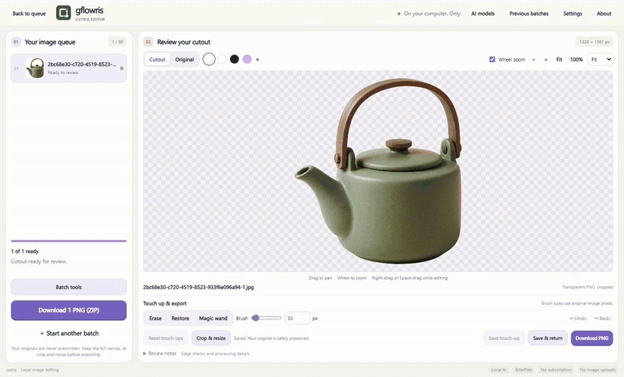

<h1 align="center">gflowris</h1>

Generate in Google Flow. Finish in Cutris.

  <a href="https://github.com/nahidmrdl/gflowris/releases">Download</a> &nbsp; | &nbsp;
  <a href="docs/setup.md">Setup</a> &nbsp; | &nbsp;
  <a href="docs/prompts.md">Prompt formats</a> &nbsp; | &nbsp;
  <a href="docs/extension.md">Chrome extension</a>

  
  

Create batches of icons, product images, portraits, and artwork from your Google Flow account. Generate, download, remove backgrounds, and refine images in one Windows workspace.

[Desktop demo](docs/assets/desktop.mp4) | [Google Flow demo](docs/assets/flow-browser.mp4)

## Made for your image workflow

| Use case | What you can do |
| --- | --- |
| Game and UI assets | Generate icon sets, remove backgrounds, and export tightly cropped PNGs. |
| Product visuals | Isolate products, clean their edges, and resize them for a catalog or storefront. |
| People and illustrations | Cut out subjects and refine difficult areas with manual touch-ups. |
| Backgrounds and artwork | Keep the original background and download at your chosen ratio and size. |

## Build a queue, then let it run

Add up to **25 prompts** with shared or individual settings. Choose the model, aspect ratio, image count, download size, and background-removal options for each card. Import text or JSON, duplicate cards, reorder them, or apply settings to a selection.

Each prompt waits for generation, downloads, and optional Cutris processing before the next begins. Pause after the active prompt or cancel the remaining queue. Drafts are saved between sessions.

## The full Cutris editor, inside gflowris

[Cutris](https://github.com/nahidmrdl/cutris) is the background remover and editor built into gflowris. Remove backgrounds locally, restore or erase details, and crop or resize the result. **Edit in Cutris** opens the complete editor in the same window. **Save & return** brings your changes back to the image gallery.

[Watch editing demo](docs/assets/cutris-editing.mp4)

Originals and earlier edits are preserved. Choose your output folder and auto-crop transparent space on export. Clearing the queue or image gallery keeps your saved files.

Exports use readable names from your prompt titles. Downloads go in `originals`; transparent PNGs and edited versions go in `cutouts`. Duplicate names are numbered automatically.

For the standalone desktop app, CLI/API, and detailed editing guides, visit the [Cutris repository](https://github.com/nahidmrdl/cutris).

## Get started

1. Download **Windows Setup** or extract the **portable ZIP** from [Releases](https://github.com/nahidmrdl/gflowris/releases).
2. Choose **Extension setup**, download the latest extension ZIP, and extract it to a permanent folder. Enter `chrome://extensions` in Chrome, enable **Developer mode**, and **Load unpacked** that folder.
3. Open your signed-in Flow project and choose **Connect this project** in **gflowris bridge**.
4. Add prompts and click **Run queue**.

The app includes its runtime and full Cutris editor. AI models download separately through **Cutris editor → AI models**; existing verified models are reused. Your Google login stays in Chrome, and background removal runs locally.

See [setup and troubleshooting](docs/setup.md), [extension permissions](docs/extension.md), and [prompt examples](docs/prompts.md). Flow models, download sizes, and limits depend on your account.

## Development

[Source setup](docs/setup.md#run-from-source) | [Architecture](docs/architecture.md) | [Contributing](CONTRIBUTING.md) | [Release workflow](docs/releasing.md)

MIT licensed. See [third-party notices](THIRD_PARTY_NOTICES.md). gflowris is an independent project, unaffiliated with Google.
